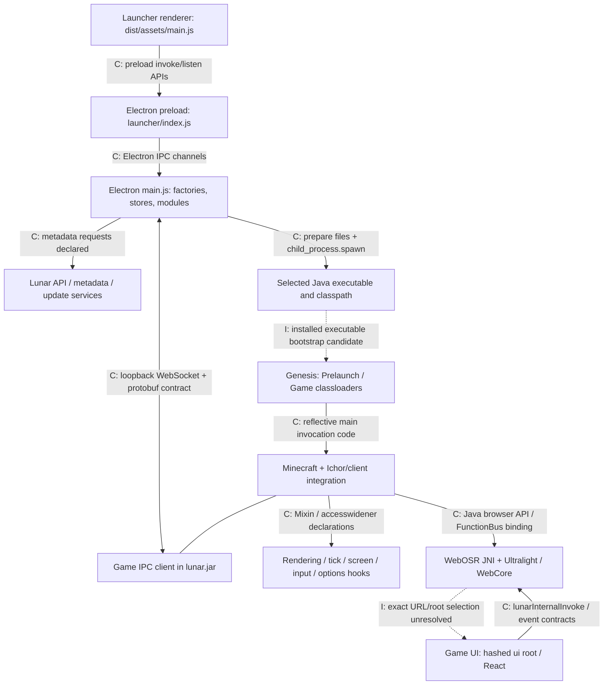

# Component map and cross-component contracts

Study date: 2026-10-11. This is a **static architecture map**, not a trace of a running session. C = confirmed declaration or file observation; I = inference; U = unresolved. Symbols and evidence anchors are expanded in the linked architecture reports.

## Boundaries

Solid edges are declarations or call/reference observations, not observed execution. The generic Minecraft-to-IPC association groups the packaged game components; its exact construction chain was not reconstructed. The launcher selects mainClass from metadata, so a manifest Main-Class is insufficient to prove the effective entry.

## Component responsibilities

| Component and location | Confirmed evidence | Interpretation and limits |
|---|---|---|
| Installed desktop EXE, `AppData/Local/Programs/Lunar Client/Lunar Client.exe` | AMD64 PE32+; Electron ASAR resources; executable hash in inventory | Desktop host; its C++ internals were not disassembled |
| `resources/app.asar!dist-electron/electron/main.js` | Manifest entry, runApp/$9, stores, module registry, BrowserWindow, spawn call | Main orchestration; minified names are build-specific |
| `dist-electron/preload/launcher/index.js` | contextBridge exposes electron/lunar; launch invoke/progress methods | Renderer/main boundary; no runtime security test |
| `dist/html/main.html`, `dist/assets/main.js` | HTML module entry and packaged UI modules | Launcher UI, distinct from the Minecraft-side React bundle |
| Main service modules | metadata FKe, launch SGe, gameipc bLe, profiles HXe, installs DLe, modrinth KKe, curseforge bNe; more in launcher report | Registry and handler responsibilities confirmed; complete intermodule graph partial |
| Launcher native addons | bsdiff, better-sqlite3, diskusage, iselevated; all x64 PE | Patch/database/disk/elevation purposes follow names plus imports/exports; actual loading unobserved |
| `.lunarclient/offline/multiver/genesis-0.1.0-SNAPSHOT-all.jar` | Genesis manifest; two classloader stages; ClientGameBootstrap reflective main invocation | Installed bootstrap candidate; effective entry depends on launch metadata |
| `lunar.jar` | Lunar client, Apollo, gameipc, WebSocket, WebOSR classes and feature callback registry | Shared feature/protocol/browser layer; extensive obfuscation limits reconstruction |
| `modern-...jar` and compatibility JARs | Mixin declarations targeting Minecraft, Sodium, Fabric, ReplayMod, etc. | Version/mod adaptation layers; selected configurations unobserved |
| `offline/multiver/natives/WebOSR-Binding.dll` | JNI browser/input/texture exports and Ultralight/WebCore imports | Embedded browser rendering boundary; native scheduling/composition unresolved |
| `.lunarclient/ui/2545e7fc28d10de3b6f9e5b8b66a4fc8931aece9` | React 18.3.1/Redux UI, route table, host invocation/event protocol | Strongly corroborated game UI family; exact URL-to-directory mapping remains unresolved |
| `.lunarclient/jre/<checksum>/...` | Three Zulu x64 runtimes, 21.0.1/21.0.10/25.0.1 | Cached alternatives; runtime selection is metadata-driven |

Evidence: [launcher architecture](launcher-architecture.md), [Minecraft architecture](minecraft-client-architecture.md), [native/runtime supplement](native-runtime-inventory.md), [launcher native addons](launcher-native-addons.md), [game UI supplement](game-ui-architecture.md).

## IPC contracts

| Boundary | Confirmed transport/contract | Evidence anchors | Unknown |
|---|---|---|---|
| Launcher renderer → Electron main | Preload invoke `launch:launchGame`; module base combines prefix:name with ipcMain.handle; listener `launch:onProgress` | L-PRELOADLAUNCH, L-IPCBASE, L-LAUNCHHANDLER | Actual invocation/order and payload values |
| Optional launcher child helper | fork call; process message dispatch and response/error/callback messages in electron/index.js | L-NATIVECHILD | Whether used; external native-modules/launcher.node presence |
| Launcher ↔ Minecraft process | Launcher WebSocketServer on 127.0.0.1, initial port 28190 with retries; --ipcPort; game WebSocketClient loopback URI; protobuf envelopes | L-GAMEIPC, L-ARGIPC, L-PORTSELECT, L-GAMEIPCMESSAGES; minecraft-ipc-metadata.json | Actual bound port, live connections, complete service semantics |
| Connection identification | Launcher reads `lc-handshake`, decodes Handshake and compares launch/installation identifiers | L-GAMEIPCMESSAGES | Runtime contents deliberately uncollected; no security/authentication conclusion |
| Game browser ↔ Java | JS lunarInternalInvoke → Java Browser.bindFunction/FunctionBus; injected lunar/lunarReady/lunarInternalAccept; CallbackJS providers | GUI-03–GUI-09; minecraft-ui-bridge-metadata.json | Threading, complete serialization/lifetime/error behavior |
| Game JNI ↔ native browser | Browser/WebOSR native methods align with JNI exports | minecraft-webosr-metadata.json; native-runtime-evidence.json | Runtime resolution and frame composition |
| MumbleLink native component | init/update JNI exports and OpenFileMappingW/MapViewOfFile imports | native-runtime-evidence.json | Shared-memory use is inference; no peer/name/payload collected |

The WebOSR bridge and game-launch IPC are separate boundaries. The preload's `window.lunar` namespace belongs to the launcher renderer; the similarly named injected game namespace is a separate implementation.

## Shared files and settings

All paths below are under the verified default `C:/Users/Admin/.lunarclient`. L-PATHS shows an overridable root, so these are not asserted universal locations.

| Path | Confirmed relationship | What remains unknown |
|---|---|---|
| `settings/launcher.json`, `settings/cache.json` | Files exist; main stores named launcher/cache use settings directory (L-SETTINGS/L-CACHE) | Personal values and effective selection were not read |
| `settings/game`, `settings/game-backup` | Directory entries and launcher game-settings path helper | Complete game persistence schema/ownership and migration behavior |
| `offline/multiver`, `offline/multiver/natives` | Core files exist; prepare stages and launch flags use classpath/native directories | Effective artifact subset per version |
| `shared/assets`, `textures` | Shared/assets/textures preparation and --assetsDir/--texturesDir declarations | Actual assets loaded |
| `ui/<sourceSha1>` and `launcher-cache` | Launcher prepares UI and passes --uiDir; installed hash directory and cached manifest/ZIP names align | Exact native browser URL/hosting scheme |
| `profiles/1.21`, `profiles/26` | Versioned mod/dependency trees exist; launcher profile/install modules declared | Active profile, selected mods and exact gameDir |
| `jre/<folderChecksum>` | Metadata-dependent executable path construction and three verified runtimes | Selected runtime and effective environment |
| `mx-cache`, `jit`, overrides | Bootstrap contracts and installed directory names where observed | Complete semantics and runtime contents |

No personal settings, identifiers, logs, databases, authentication material or handshake payloads are included in the evidence.

## Declared network dependencies

**Confirmed static declarations, not observed requests:** production/dev Lunar API helpers, /launcher/metadata/versions/lunar and /launcher/launch, launcher release feed, launcher-v3 remote WebSocket, authenticator WebSocket, analytics event batch endpoint; see L-APIBASE/L-METADATA/L-LAUNCHREQUEST/L-REMOTEWS/L-UPDATEBASE and launcher source evidence. User/account-dependent branches include Microsoft/Xbox/Minecraft authentication, mod providers, Discord and Overwolf; inclusion does not establish that each is active.

Game UI declares Google Fonts, servermappings.lunarclientcdn.com assets, img-proxy.lunarclient.com, skycrypt-embed.lunarclient.com/stats and a Sentry ingest endpoint. Support/store destinations are links. See GUI-11–GUI-14. The exact Sentry DSN is omitted. Native socket/crypto imports are dependency declarations, not proof of additional endpoints.

No network traffic was captured and no endpoint was contacted as part of this study.
