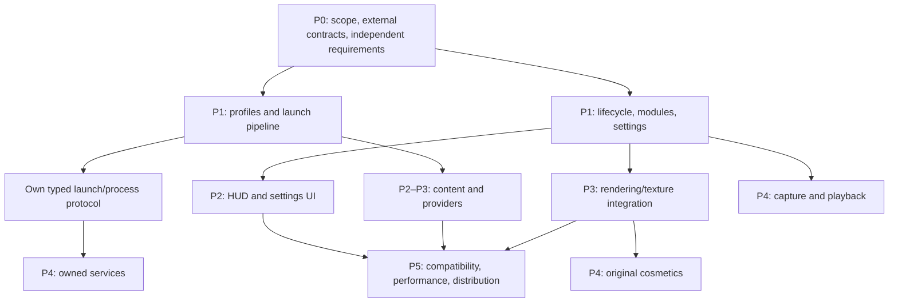

# Development roadmap for an independent comparable client

Study date: 2026-10-11. **Planning only; no client implementation has begun.** Target: a new launcher and Minecraft extension with original UI/assets, independent code, storage and services. Shipping Lunar JARs, JS, native modules, translations, textures or models is outside this plan.

A substantial local-functionality product appears feasible. Exact Lunar behavior, visuals, performance and service interoperability are not established. Priority reflects user value, evidence, dependencies and uncertainty.

## Planning assumptions

1. Start with one explicitly selected Minecraft version/loader and Windows x64. Installed profiles and compatibility JARs do not establish every supported version.
2. Use an authorized Minecraft runtime and separately verified account/version/assets/library/loader contracts. The new launcher should not depend on Lunar /launcher/launch responses or Genesis/Ichor internals.
3. Define independent, versioned profile/settings/event/launch schemas and original UX. A missing Lunar detail can often be replaced by a documented new design.
4. Build local capabilities first. A chat screen does not provide message delivery; a timeline does not provide recording/playback.
5. Acceptance checks below are **future tests of the new product**, not tests performed during this investigation.

## Prioritized milestones

| Priority / milestone | Deliverable | Evidence / dependencies | Acceptance gate | Size; uncertainty |
|---|---|---|---|---|
| P0 — Requirements and scope | Choose version/loader/OS, initial feature set, original assets and independent schema/contracts | Feature inventory; ME-01/02/03 decisions | Each selected feature has inputs/outputs, failure/cancel behavior and a requirement test; no unavailable Lunar service dependency | Small–medium; moderate |
| P0 — External integration verification | Verify authorized account, game metadata, loader/provider interfaces and dependency distribution conditions before selecting packages | Local artifacts establish boundaries, not current third-party API/compatibility rules | Documented sources and fixtures for chosen launch path | Medium; external constraints unknown |
| P1 — Launcher/profile vertical slice | Original shell; profile create/clone/select/delete; version/game directory/RAM/resolution; persistent settings | Launcher profile/settings/launch contracts | Create profile → prepare permitted runtime → start → stop/exit → relaunch; restart persistence and actionable errors | Medium; moderate |
| P1 — Reliable launch orchestration | Cache/hash checks, artifact/runtime/native preparation, progress, JVM argument builder, cancellation and exit classification | launcher lifecycle/stages, process observer and IPC findings | Interrupted/corrupt-download cases recover; cancel terminates owned work/processes; no stale running state | Medium–large; moderate |
| P1 — Game extension framework | Tick/render/input/screen adapter, module enable/disable, typed settings, keybinds, local persistence | Minecraft feature base classes/settings and Mixin targets | One feature can enable, render, change/persist settings and disable without residual listeners/resources | Medium; version integration risk |
| P2 — Local HUD suite | Selected info/telemetry features with independently specified metrics; move/scale/visibility editing | Named feature catalog; HUD geometry; exact metrics/layout unknown | Defined sampling/formatting; correct placement at GUI scales/resolutions; saved state and input focus | Medium; moderate per widget |
| P2 — Settings and navigation | Categories/search, typed controls/reset, keybind conflicts, overlays, profile editor and focus/escape behavior | game UI control/schema/route findings; launcher renderer hierarchy | Keyboard/mouse navigation, invalid-value feedback, reset semantics and focus ownership work | Medium; original UX is new work |
| P2 — Local content management | Mod/resource-pack/shader toggles; own profile import/export; worlds/datapacks; folder reveal | Preload profile/world/content operations and launcher validation | Independent conflict/path/partial-import policies; chosen-version content lifecycle works | Medium–large; loader/format risk |
| P2 — Local utilities | Screenshots/favorites/copy, server lists/ping/favorites, notes/backups and redacted diagnostics | Exact launcher IPC affordances | Complete local CRUD/import/persistence scenarios; recoverable filesystem/network errors | Medium; lower algorithm uncertainty |
| P3 — Rendering/preview/waypoint slice | Choose native game UI or independent permitted renderer; one original model preview and local waypoint system | WebOSR/TextureHandler declarations; gameTexture/model wrappers | Verify texture ownership, resize/destruction, input coordinates, preview lifetime and world scoping | Large; high |
| P3 — Provider/modpack workflows | One verified provider first: search/dependencies/install/update, then conflict handling/second provider | Modrinth/CurseForge IPC families/profile links | Reproducible resolution, cancellation/rollback, pack divergence and provider-error UX | Large; external/schema risk |
| P3 — Version expansion | Per-version integration adapters and compatibility matrix | Versioned Mixin/compatibility artifacts demonstrate adaptation burden | Lifecycle/render/input/settings regressions pass per declared version/combination | Large and continuing; high |
| P4 — Owned social services | Own friends/presence/chat/notifications/profile sharing with delivery/reconnect/moderation semantics | UI/protocol namespaces identify surfaces, not backend implementation | Two independent clients complete end-to-end workflows; durable failures handled | Large; high; Lunar identity/network parity unavailable |
| P4 — Original cosmetics/emotes | Original content/formats, rendering, preferences and optional owned entitlement model | Model/locker/emote/provider surfaces | Defined lifecycle; own ownership model; no Lunar inventory/assets assumed | Large; high |
| P4 — Replay/Rewind/export | Independent capture/state/timeline/serialization/playback/export architecture; narrow recording slice first | Rewind APIs and ReplayMod/Flashback adaptation; recording internals missing | Record → replay → seek/edit/export within defined limits; UI alone does not count | Very large; very high |
| P4 — Domain-specific assistance | Select individual server/SkyBlock/world features and define permitted data inputs and rules | Candidate catalog IDs and Java/UI namespaces | Reliable data source, defined algorithms and version coverage for each feature | Potentially very large; feature-dependent |
| P5 — Distribution and quality | Own updater/feed, install recovery, packaging, telemetry choice, compatibility reporting, memory/performance QA | Updater/cache/diagnostic boundaries; no original performance baseline | Clean install/update/recovery matrix, resource budgets and soak tests; measured support claims | Large; continuing |

Sizes are relative engineering judgments, not person-week estimates. Calendar estimates require team capacity, release target, feature count and supported versions. Rendering, services, replay and compatibility expansion dominate uncertainty.

## Recommended first release

Include one verified launch path, original profile/settings UI, robust start/cancel/exit lifecycle, a small specified local HUD suite, module/keybind/config framework, local servers/screenshots and diagnostics.

Defer Lunar interoperability, store/entitlements, music/promotions/Overwolf/other-client integrations, full replay/export, broad version coverage and extensive domain-specific packs. Their presence is better established than their detailed semantics.

Even the first release needs new specification choices: FPS sampling/formatting, HUD snapping/layout, clone contents and recovery policies are not all recovered from Lunar.

## Dependency structure

The observed loopback/protobuf design demonstrates responsibility separation. The new client can use its own request/event protocol; reproducing Lunar installation identifiers and private wire compatibility is unnecessary for independent functionality.

## Decisions that most affect feasibility

| Decision | More bounded route | Greater-cost route |
|---|---|---|
| UI renderer | New native Minecraft screens for equivalent controls/navigation | New web renderer requiring texture/input/thread integration |
| Version support | One explicit version/loader/OS with measured expansion | Immediate parity across all apparent combinations |
| Config | New versioned schema/defaults and permitted optional imports | Exact Lunar persistence/migration compatibility without complete schema |
| Metadata | Independent adapter for separately verified game/loader data | Private Lunar launch-response dependence |
| Social | Local first, later own service | Interoperation with Lunar users/history/entitlements |
| Replay | Separate narrow capture/playback milestone | Promise of complete Rewind from UI evidence |
| Visual/content | Original assets and UX | Pixel/asset parity outside this scope |

## Evidence gates

- Close requirements gaps before calling a selected feature implementation-ready. Names, localization keys and API wrappers do not specify algorithms.
- Record new design decisions separately from recovered evidence.
- Gate rendering on an independent texture/input/lifetime experiment, and replay on actual capture/playback.
- Measure the new product against defined performance budgets. No original Lunar FPS/latency/resource/visual-parity measurements were collected.
- Obtain separate approval before any future original-app runtime observation. No launch/attach/instrumentation is authorized by this roadmap.
- Exclude anti-cheat/protection work. An inaccessible backend or entitlement system is not a bypass objective.

See [reconstruction-feasibility.md](reconstruction-feasibility.md) for ratings and [missing-evidence.md](missing-evidence.md) for gaps that can be replaced by new design.
