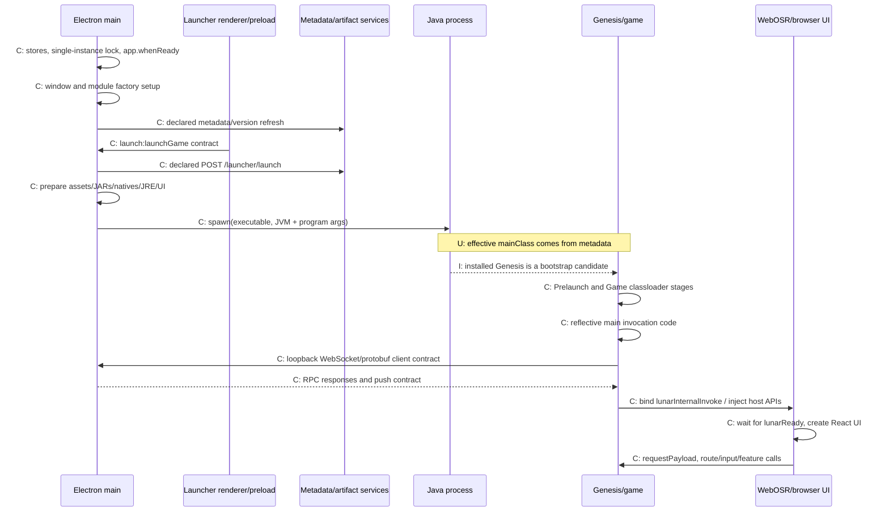

# Static startup flow

Study date: 2026-10-11. This reconstructs possible control flow from packaged code and metadata. It does not describe an observed launch. C = confirmed static code/declaration; I = inference; U = unresolved runtime selection.

## High-level sequence

The diagram condenses several conditional/asynchronous branches. It does not assert that version refresh, downloads, IPC connection and browser initialization occur in a single strict linear order.

## Launcher initialization

1. **C:** package.json selects `dist-electron/electron/main.js`. Its tail invokes `$9`, exported as runApp. Pre-ready initialization constructs stores/factories, validates the default home-relative Lunar directory and uses `n1e` to request a single-instance lock outside the E2E branch. L-INIT, L-PATHS, L-SINGLEINSTANCE.
2. **C:** app.whenReady callback configures tray/startup behavior, handles arguments/deeplinks/imports and calls `K9.setup()` for windows and `$.setup()` for modules. Profile migration has a finally-triggered updater check. Cleanup hooks exist for quit/signals. L-INIT.
3. **C:** the window base creates BrowserWindow with a launcher preload. HTML loads dist/assets/main.js. The preload exposes electron/lunar APIs through contextBridge. L-WINDOW, L-RENDERERENTRY, L-PRELOADBRIDGE.
4. **C:** modules include metadata FKe, launch SGe and gameipc bLe. The game IPC module declares a loopback WebSocket server, initial port 28190, bounded collision retries, then retains its actual listening port. It is initialized with the service modules, rather than proven to start only after a launch click. L-REGISTRY, L-GAMEIPC.
5. **C:** metadata setup fetches/stores version data and schedules refresh; the updater uses metadata feed/channel/interval with a 900000ms fallback. These are conditional request/check paths, not observed downloads. L-METADATA, L-UPDATER.

## Launch preparation and process boundary

6. **C:** renderer launchGame invokes `launch:launchGame`. Main module SGe registers launchGame/cancel/respondMemoryWarning through prefix-based ipcMain.handle. Progress has a separate listener channel. L-PRELOADLAUNCH, L-LAUNCHHANDLER, L-IPCBASE.
7. **C:** `lRe` declares a POST to `${Vy()}/launch` using selected version/branch/module/profile/arguments. `zUe` consumes response metadata including JRE, artifacts and mainClass. **U:** the actual response, selected profile and effective main class were not obtained. L-LAUNCHREQUEST.
8. **C:** `LUe` composes preparation stages for licenses, textures, shared assets, core artifacts, native libraries, JRE and UI, with optional Fabric/modpack handling. Code paths can use cached files or perform downloads. **U:** exact dependency subset and stage execution during a particular session. L-STAGES.
9. **C:** `g$` resolves the Java executable from the Lunar JRE root, metadata folderChecksum and executablePathInArchive. Three cached x64 Zulu versions were independently verified. Installed presence does not establish selection. L-JREPATH; native-runtime-evidence.json.
10. **C:** `bRe` assembles memory/native/classpath/mainClass arguments; `yRe` supplies game/assets/textures/UI/WebOSR/classpath directories and --ipcPort. The chosen port is gameipc.port with 28190 fallback. Code references authentication fields but no actual values were collected or reproduced. L-JVMARGS, L-ARGDIRS, L-ARGIPC, L-PORTSELECT.
11. **C:** child_process.spawn uses the computed executable/arguments, working directory, detached flag and merged environment. Optional wrapper/prelaunch/postexit branches are declared; no configured commands were inspected or executed. Process-observation/exit handling exists. L-SPAWN. **U:** actual command line, environment and launched process state.

## Installed Minecraft bootstrap candidate

12. **C:** Genesis archive manifest declares `com.moonsworth.lunar.genesis.Genesis` as Main-Class. Genesis.main calls initialization and run. **I:** it is an installed entry candidate for the launcher metadata contract; it is not proven to be the selected entry of any launch.
13. **C:** Genesis.run constructs classloaders with Prelaunch/Game labels and argument records for PreLaunchLibraryBootstrap and ClientGameBootstrap, then invokes loader helpers. PreLaunchLibraryBootstrap declares library/Fabric-loader configuration and download methods. Exact branch/reflection targets remain partial. See minecraft-bootstrap-metadata.json.
14. **C:** ClientGameBootstrap.apply references Class.forName, getMethod(`main`) and Method.invoke. **U:** its runtime-resolved Minecraft entry. Ichor classloader APIs, native path properties and directory flags establish integration contracts.
15. **C:** shipped Mixin/accesswidener metadata targets Minecraft lifecycle, rendering, screens, keyboard/mouse and options methods. **U:** exact version-conditioned activation and successful transformations. No mappings or transformations were applied by this study.

## IPC and browser UI

16. **C:** the game-side WebSocketClient constructor forms `ws://127.0.0.1:<runtime integer>`; handlers parse GameboundIPCMessage and register push notifications such as PlayServerPush/ExitGamePush/FocusGamePush. Main server parses handshake and LauncherboundIPCMessage, dispatches service methods and emits GameboundIPCMessage. **I:** these matching static contracts identify the launcher/game pairing. **U:** actual port/connection/payloads. L-GAMEIPCMESSAGES; minecraft-ipc-metadata.json.
17. **C:** a class in lunar.jar binds `lunarInternalInvoke` to Browser.bindFunction using its FunctionBus at method bytecode offsets 58/61/64. A document-ready listener embeds an IIFE defining lunar, lunarReady and lunarInternalAccept. Exact obfuscated class path and references are preserved in minecraft-ui-bridge-metadata.json.
18. **C:** the installed game UI bundle's T91 checks window.lunar/lunarReady, retries every 500ms until ready and then initializes React providers/router/error boundary. c0 invokes lunarInternalInvoke; S2 manages payload subscriptions. Routes/settings/HUD/model/input wrappers cross this boundary. GUI-01–GUI-10.
19. **C:** native Browser methods match WebOSR JNI exports and Ultralight/WebCore imports, including texture/input operations. **I:** this supports embedded browser UI composition into the game. **U:** exact UI URL/root selection, first-render ordering, thread ownership and texture lifetime.

Evidence excerpts, source hashes and offsets are linked from [launcher-architecture.md](launcher-architecture.md) and [minecraft-client-architecture.md](minecraft-client-architecture.md). No binaries were launched, runtime hooks attached, packets captured, or credentials/identifiers collected.
